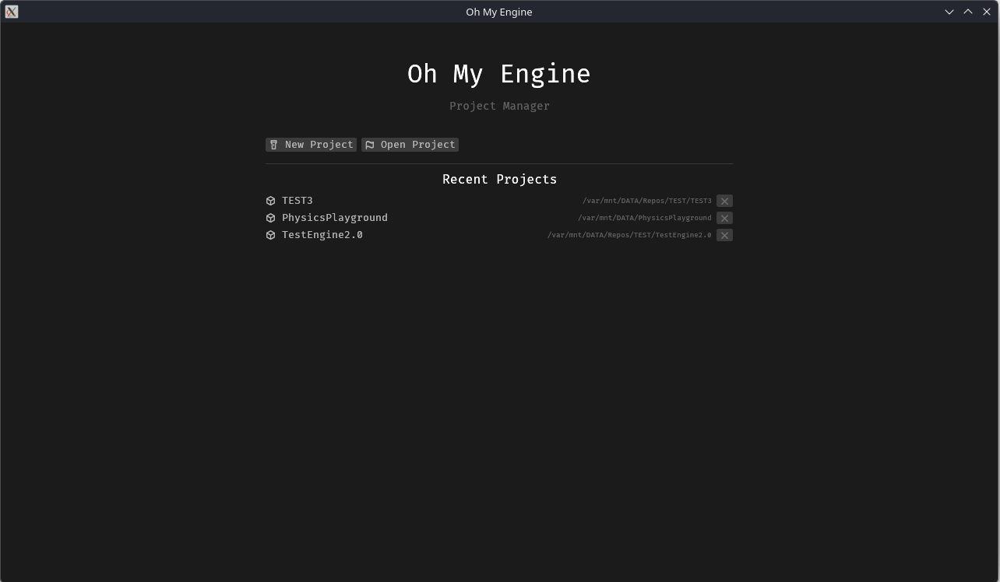

# Your First Project

<!-- toc -->

A complete pass through the loop: create a project, write a component and a system, and watch
them run. Roughly fifteen minutes, most of it the first compile.

## 1. Open the Hub

```bash
cargo run -p kooch_editor
```



Create a project, or open one you have. The first build of a new project compiles the engine
too — several minutes, once.

> A project made with an older editor is migrated on open. You do not have to do anything, but
> that first build will also be a full one.

## 2. Write a component

In the **Asset Browser**, right-click `src/` → **New Script** → **Component (Rust)**, and name it
`Spinner`. The editor writes `src/spinner.rs` from its scaffold. Replace the struct with:

```rust
use kooch::prelude::*;

/// Makes an entity rotate. Attach it and set the speed in the Inspector.
#[derive(Reflect)]
#[reflect(category = "Gameplay")]
pub struct Spinner {
    /// Degrees per second around the Y axis.
    pub speed: f32,
}

impl Default for Spinner {
    fn default() -> Self {
        // Not zero: a spinner that does not spin reads as a broken system.
        Self { speed: 90.0 }
    }
}

impl Component for Spinner {}
```

`speed` is public, so the Inspector draws a field for it. Everything a script needs comes from
`kooch::prelude` — see [Writing a Component](./components.md) for the attributes that change how a
field is drawn.

## 3. Write a system

Right-click `src/` → **New Script** → **System (Rust)**, named `spin`. Fill in `src/spin.rs`:

```rust
use kooch::prelude::*;

use crate::registrations::spinner::Spinner;
# mod registrations { pub mod spinner {
#     use kooch::prelude::*;
#     #[derive(Default, Reflect)]
#     pub struct Spinner { pub speed: f32 }
#     impl Component for Spinner {}
# } }

/// Rotates every entity that has a `Spinner`.
#[system]
pub fn spin(resources: &mut Resources) {
    let dt = Time::of(resources).delta_secs();
    Query::<(&Spinner, &mut Transform)>::new(resources).for_each(|(spinner, transform)| {
        transform.rotation *= Quat::from_rotation_y(spinner.speed.to_radians() * dt);
    });
}
# fn main() {}
```

Three things in there are worth knowing from the start:

- **Your own types are reached through `crate::registrations::…`.** The editor mounts every script
  inside that generated module, mirroring your `src/` folders; the absolute path reads the same
  from any file.
- **`#[system]` puts it in `Update`, running only while playing.** The scaffold says which other
  stages exist; [Writing a System](./systems.md) says when to pick one.
- **`Time::of(resources)`** is the frame's time. `delta_secs` is game time, so a paused game stops
  spinning; see [Time](../guide/time.md).

The query matches only entities that have **both** components, so a `Spinner` on an entity with
no `Transform` is skipped, not an error. `Vec3`, `Quat` and the rest of `glam` come through the
prelude too — don't add your own `glam` to `Cargo.toml`: a `Quat` from another version is a
different type, and the error names two types spelled identically.

## 4. Build

Registration already happened. The editor watches `src/`, found `impl Component for Spinner` and
the `spin` system, and rewrote `registrations.rs` with both — within a second of you saving, from
whichever editor you saved in.

Registering is not compiling. Press **Rebuild & Run** in the toolbar — it pulses whenever `src/`
has moved ahead of the last build. It compiles the project, reloads its code into the editor and
relaunches the game, carrying the open scenes across, unsaved edits included. Compiling is still
the slow part of the loop: Rust is built ahead of time.

## 5. Use it

With the rebuild done:

1. Select an entity in **World** (or spawn one).
2. **Add Component** → *Gameplay* → `Spinner`.
3. `speed` starts at `90`; change it in the **Inspector** if you like.
4. Press **Play**.

It spins. Press **Stop** and the world returns exactly as you authored it — Play snapshots
before it starts and restores on stop, so testing never costs you your scene.

## What to read next

- [Writing a Component](./components.md) — every field type the Inspector can draw, and the
  attributes that control it
- [Writing a System](./systems.md) — queries, stages, spawning
- [Recipes](./recipes.md) — the short way to write what every game writes
- [Creating a Project](./creating-a-project.md) — what each generated file is for
- [The Editor](../editor/overview.md) — the panels, and what is not built yet

## If something did not work

| Symptom | Cause |
|---|---|
| The component is not in the Add Component menu | The project has not been rebuilt since it was written — registering is not compiling. Press **Rebuild & Run** |
| A field is not in the Inspector | It is private, has `#[reflect(skip)]`, or is a type reflection does not support yet ([#649](https://github.com/lobinuxsoft/kooch/issues/649)) |
| The derive does not compile | A field's type is not supported — nested structs and `Vec<T>` are; `HashMap` and enums carrying data are not yet. Mark it `#[reflect(skip)]` |
| The system never runs | It is in `Update` behind the `Playing` gate; press Play. Or its signature does not match `pub fn f(resources: &mut Resources)` on one line, so the scanner missed it |
| The system runs in the wrong stage | Say which with `#[system(PreUpdate)]`; without it, every system lands in `Update`. See [Writing a System](./systems.md) |
| A child object or shadow lags one frame behind | The system writes a `Transform` in `PostUpdate` or later, after the engine already resolved `GlobalTransform`. Move it to `Update` |
| Play opens a second window and takes minutes | The old local-Play path ([#633](https://github.com/lobinuxsoft/kooch/issues/633)) |
